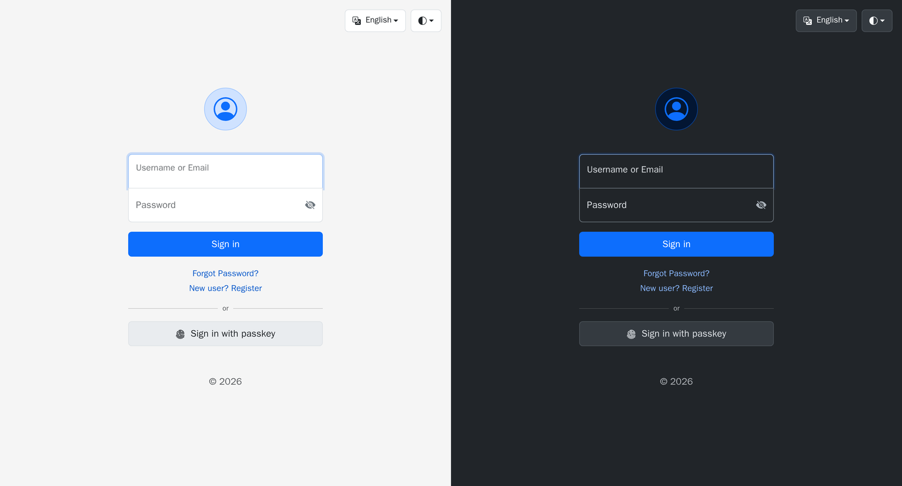
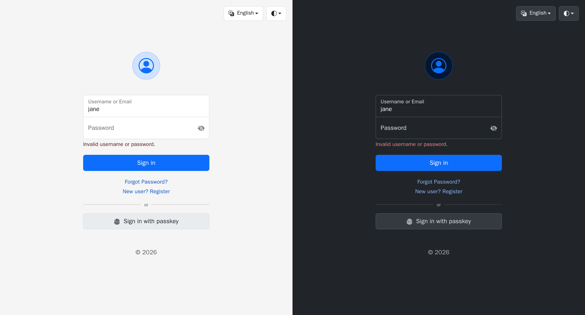

# Keycloak Bootstrap Theme

Keycloak Bootstrap Theme is a login and email theme for <a href="https://github.com/keycloak/keycloak">Keycloak</a> that renders the visitor-facing pages with the <a href="https://github.com/twbs/bootstrap">Bootstrap</a> front-end framework, based on Bootstrap's "Sign-in" example. It is meant to give a seamless look and feel when visitors come from a project that already uses a Bootstrap layout.

Plain FreeMarker templates and CSS: no React, no Node.js at runtime, no CDN.



---

## Features

- **Bootstrap 5.3** look and markup, light and dark mode (system setting or the switcher at the top right), no flash of the wrong colours on load
- **Strict Content-Security-Policy:** no inline scripts, no inline styles, no import map; works with `script-src 'self'; style-src 'self'` (see [Strict CSP](#strict-csp))
- **Passkeys:** sign-in button, passkey AutoFill (conditional UI) in the username field, passkey/security key registration
- **Accessible:** WCAG AA contrast in both modes, Bootstrap's focus ring, logical tab order, translated screen-reader labels, keyboard-operable menus
- **Fast:** icons inline (no extra request), unused Bootstrap CSS removed and theme CSS/JS minified at build time, no Bootstrap JavaScript bundle
- **Languages:** English, German, French, Spanish (login and email)
- **Pages:** login, registration, password reset/update, e-mail verification, TOTP setup and input, passkey/WebAuthn, select authenticator, terms, info/error, logout, SAML/front-channel helpers; all other pages fall back to Keycloak's base templates in the same layout



---

## Requirements

- Keycloak `26.8.2` (the overridden templates follow this version; see [Upgrading Keycloak](#upgrading-keycloak))
- Docker (or any OCI builder) to build; Bootstrap and the icons are included

---

## Installation

The theme folder in this repository is the source. The build adds Keycloak's own passkey modules
(they cannot be shipped here, they belong to your Keycloak version) and optimises the assets.
**Without the build, passkeys do not work.**

### Option A: Keycloak image with the theme

```sh
git clone https://github.com/disisto/keycloak-bootstrap-theme.git
cd keycloak-bootstrap-theme
docker build -t keycloak-bootstrap .
```

Use `keycloak-bootstrap` instead of `quay.io/keycloak/keycloak:26.8.2`, or copy the last stage of
the `Dockerfile` into your own image build. A different Keycloak version: `--build-arg KC_VERSION=…`.

### Option B: only the theme folder

```sh
docker build --target theme --output type=local,dest=dist .
```

Copy `dist/bootstrap-signin-theme` into the `themes/` directory of your Keycloak installation and
restart Keycloak.

### Enable the theme

Admin console > *Realm settings* > *Themes*: set **Login theme** (and optionally **Email theme**) to
`bootstrap-signin-theme`.

### Passkeys

Admin console > *Authentication* > *Policies* > *Webauthn Passwordless Policy*: enable
**Passkeys**. The login page then shows "Sign in with passkey" and offers saved passkeys in the
username field's AutoFill.

---

## Strict CSP

The theme needs no `unsafe-inline`. Keycloak's own pages (account console, third-party-cookie check,
login-status iframe) still contain inline code, which is allowed by hash. `tools/csp.py` reads those
hashes from your running Keycloak and prints a complete policy:

```sh
tools/csp.py https://sso.example.com my-realm
# options: --frame-src https://app.example.com  --connect-src https://api.example.com
```

Set the output under *Realm settings* > *Security defenses* > *Headers* > *Content-Security-Policy*.
The hashes change with every Keycloak version, so run it again after each upgrade.

---

## Customization

All options are in `themes/bootstrap-signin-theme/login/theme.properties`.

| Setting | Options |
|---|---|
| Logo | `customLogoIcon` = any symbol id from `login/sprite.ftl` (round badge in the primary colour), or `customLogoUrl` = an image URL; size in `.kc-logo` (`css/sign-in.css`) |
| Favicon | `customFaviconPath` (inside the theme) or `customFaviconUrl` |
| Copyright year | `copyrightYearMode` = `none`, `current`, `range` (with `copyrightStartYear`), `hardcoded` (with `copyrightYear`) |
| Copyright signature | `copyrightSignatureMode` = `none`, `realm` (realm display name), `custom` (with `copyrightSignature`) |
| Cache-buster | `assetVersion`: Keycloak caches theme files for 30 days; change it whenever you change a file under `resources/` |

**Individual design:** put your styles in `login/resources/css/sign-in.css` (loaded after Bootstrap).
Avoid `style="…"` attributes and inline `<script>`, they break a strict CSP. Classes that only a
script adds at runtime must be added to the safelist in `build/purgecss.cjs`, otherwise the build
removes their Bootstrap rules.

**Texts:** `login/messages/messages_<lang>.properties` override Keycloak's texts; everything not
listed there comes from Keycloak.

---

## Upgrading Keycloak

1. Set `KC_VERSION` in the `Dockerfile` (the build fails if Keycloak's passkey modules changed in a way the build does not expect).
2. Compare the overridden templates in `login/*.ftl` with the new `theme/base/login` of Keycloak.
3. Rebuild, test login, registration, passkeys and TOTP, then re-run `tools/csp.py` and update the realm's CSP.

---

## License

MIT, see [LICENSE](LICENSE), except for the parts derived from Keycloak: the login page templates
and some login texts are modified versions of Keycloak's base theme and remain under the
[Apache License 2.0](LICENSES/Apache-2.0.txt) (each file's header says `MIT AND Apache-2.0`).
Details and the other third-party components: [THIRD-PARTY-NOTICES.md](THIRD-PARTY-NOTICES.md).

---

This project is not affiliated with <a href="https://keycloak.org/">Keycloak</a> and/or <a href="https://getbootstrap.com/">Bootstrap</a>.<br>All mentioned trademarks are the property of their respective owners.
